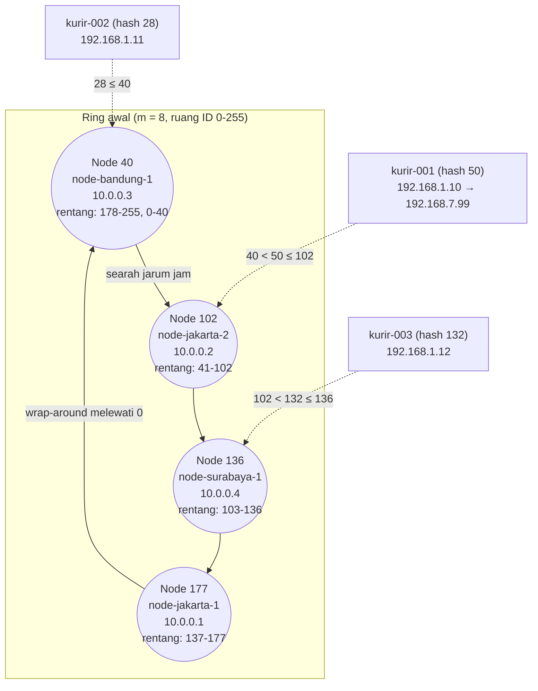
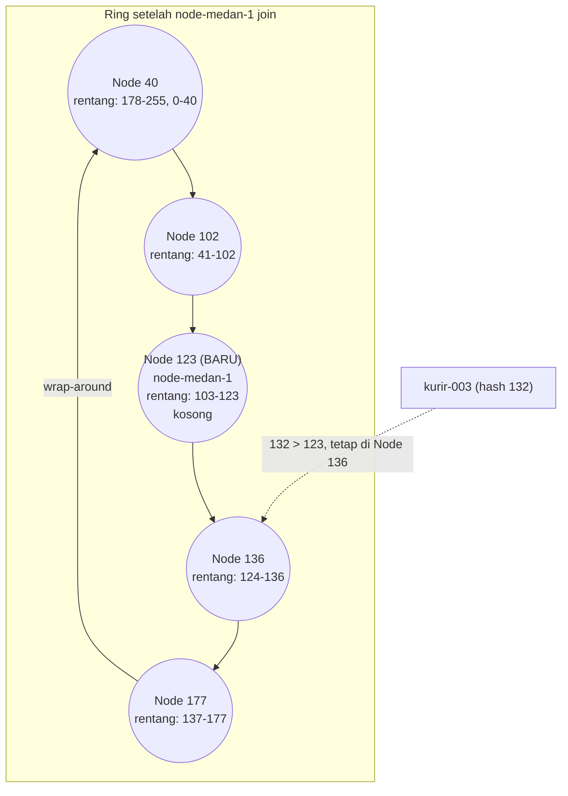
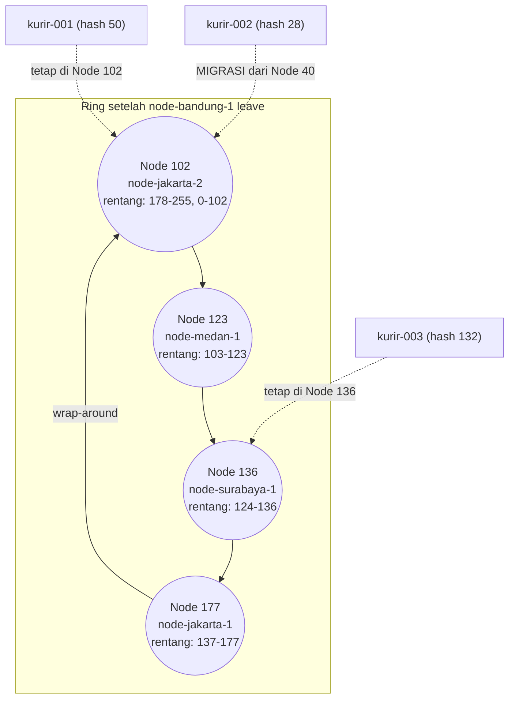

# Tugas 6 (Pekan 6) — Penamaan & Resolusi Lokasi

**Materi terkait:** Flat Naming, Structured Naming (DNS), Distributed Hash Table (DHT)/Chord.

## Studi Kasus

Pelanggan FoodGo kesulitan menemukan alamat IP server kurir yang **dinamis** (kurir berpindah lokasi/jaringan, IP-nya sering berubah). FoodGo butuh cara memetakan **ID Kurir** (identitas tetap) ke **alamat IP terkininya** tanpa server pusat tunggal yang jadi bottleneck/single point of failure.

## Tugas Kelompok

Implementasikan **simulasi Chord DHT** sederhana (single-process, tidak perlu jaringan sungguhan — cukup simulasi struktur data & algoritma di satu program Python) yang memetakan ID Kurir ke alamat IP mereka.

Konsep yang harus terlihat jalan dalam simulasi kalian:
1. **Consistent hashing**: ID Kurir dan ID Node di-hash ke ruang angka yang sama (mis. 0–255 untuk kesederhanaan, `m=8` bit).
2. **Ring topology**: node-node diurutkan melingkar berdasarkan hasil hash-nya.
3. **Lookup**: fungsi `lookup(kurir_id)` yang menemukan node mana yang bertanggung jawab menyimpan mapping ID Kurir tersebut → alamat IP-nya (aturan Chord: node dengan ID hash **terkecil yang lebih besar atau sama dengan** hash key, disebut *successor*).
4. **Perubahan topologi**: simulasikan minimal satu node baru bergabung (`join`) atau satu node keluar (`leave`), tunjukkan bagaimana mapping berpindah tanggung jawab ke node lain.

Skeleton disediakan di `src/chord_simulation.py` dengan fungsi hashing dan struktur ring sudah ada — bagian `lookup()`, `join()`, dan `leave()` sengaja dikosongkan.

### Cara Menjalankan

```bash
python3 src/chord_simulation.py
```

## Tugas Analisis (`README.md`)

1. Jelaskan **kenapa DHT/Chord** lebih cocok untuk kasus ini dibanding **flat naming sederhana** (mis. tabel pusat ID→IP) atau **DNS konvensional** — kaitkan dengan sifat "IP kurir sering berubah" dan kebutuhan tanpa titik gagal tunggal.
2. Gambarkan (boleh pakai Mermaid, lihat Tugas 2) ring topology dari simulasi kalian, tandai node mana yang bertanggung jawab atas ID Kurir mana.
3. Jelaskan apa yang terjadi pada mapping saat sebuah node **keluar** dari ring (siapa yang mengambil alih tanggung jawabnya) — dukung dengan output program.

## Struktur Submission

```
tugas-06-penamaan-dht/
├── README.md      # Analisis + diagram ring
├── JURNAL.md
├── src/
│   └── chord_simulation.py
└── bukti/          # Output program (screenshot/log) untuk skenario join & leave
```

## Rubrik Penilaian (Tugas 6)

| Komponen | Bobot | Kriteria |
|---|---|---|
| Implementasi lookup/join/leave benar | 35% | Consistent hashing & successor lookup sesuai aturan Chord |
| Bukti perubahan topologi (join/leave) | 25% | Output menunjukkan mapping berpindah dengan benar |
| Analisis kenapa DHT vs flat naming/DNS | 25% | Argumen spesifik ke kasus IP kurir dinamis, bukan definisi umum |
| Proses & kontribusi kelompok | 15% | `JURNAL.md`, commit history |

## Batasan Penggunaan AI (Level 2)

Kebijakan **Level 2 (AI Assisted Idea Generation & Structuring)** berlaku — lihat [`../RUBRIK-UMUM.md`](../RUBRIK-UMUM.md). Boleh bertanya konsep umum consistent hashing/Chord ke AI; **tidak boleh** meminta AI menuliskan isi `# TODO` di `src/chord_simulation.py` (`find_successor`, `join`, `leave`, dst). Catat pemakaian AI di "Log Penggunaan AI" pada `JURNAL.md`.

- `README.md` wajib menelusuri manual (langkah demi langkah) bagaimana `lookup()` menemukan successor untuk salah satu ID Kurir contoh yang dipakai di `chord_simulation.py` — bukan cuma menempelkan output program.

## Analisis

### 1. Mengapa DHT/Chord Lebih Cocok Dibandingkan Flat Naming Sederhana atau DNS Konvensional

- **Tabel pusat ID→IP:** semua lookup dan update lewat satu server, yang menjadi bottleneck dan single point of failure. IP kurir sering berubah, jadi server itu terus menerima update.
- **DNS konvensional:** hierarkinya cocok untuk nama yang relatif statis dan bergantung pada caching/TTL. IP kurir yang cepat berubah membuat cache cepat basi, dan update harus lewat otoritas zona tertentu.
- **Chord:** hash `kurir-001` selalu 50, jadi node penanggung jawabnya tetap meski IP-nya berubah. Yang diperbarui hanya nilainya, seperti yang terlihat pada `register_kurir("kurir-001", "192.168.7.99")`. Tidak ada titik pusat. Pada Chord penuh dengan finger table, lookup membutuhkan O(log N) langkah; simulasi ini menyederhanakannya dengan pencarian linear pada daftar node terurut (`successor_in`).

### 2. Diagram Ring Topology

Ruang identifier memakai m = 8 bit (0-255). ID node dan ID kurir di-hash dengan SHA-1 lalu diambil modulo 256, sehingga keduanya berada di ruang yang sama (consistent hashing). Node diurutkan melingkar berdasarkan hash-nya: 40 → 102 → 136 → 177 → kembali ke 40 (wrap-around). Setiap node bertanggung jawab atas key di antara node pendahulunya (tidak termasuk) sampai dirinya sendiri (termasuk).

| Node | ID | IP Node | Rentang tanggung jawab | Kurir yang disimpan |
|---|---|---|---|---|
| node-bandung-1 | 40 | 10.0.0.3 | 178-255, 0-40 | kurir-002 (hash 28) |
| node-jakarta-2 | 102 | 10.0.0.2 | 41-102 | kurir-001 (hash 50) |
| node-surabaya-1 | 136 | 10.0.0.4 | 103-136 | kurir-003 (hash 132) |
| node-jakarta-1 | 177 | 10.0.0.1 | 137-177 | tidak ada |

Node 177 tidak memegang mapping karena belum ada kurir yang hash-nya jatuh pada rentang 137-177. Hal ini wajar pada jumlah sampel kecil.



Setelah `node-medan-1` join:



### 3. Apa yang Terjadi saat Node Keluar

Setelah `node-bandung-1` leave:



Node `node-bandung-1` (id 40) keluar. Sebelum keluar, node ini menyimpan mapping `kurir-002` (hash 28). Setelah node 40 dihapus, `find_successor(28)` mencari node terkecil dengan ID ≥ 28 pada node yang tersisa (102, 123, 136, 177), dan hasilnya node 102 (`node-jakarta-2`). Mapping `kurir-002` pun dipindahkan ke node 102, sedangkan IP kurirnya tidak berubah (192.168.1.11). Rentang node 102 melebar menjadi 178-255 dan 0-102. Node 123, 136, dan 177 tidak terpengaruh, dan `kurir-001` serta `kurir-003` tetap berada di node masing-masing.

Bukti output program (`python3 src/chord_simulation.py`):

```bash
[LEAVE] Node 'node-bandung-1' (id=40) keluar dari ring.
  [MIGRASI] kurir-002: node 40 -> node 102 (10.0.0.2), IP kurir tetap 192.168.1.11

[RING] Urutan node (searah jarum jam):
  id=102 node-jakarta-2   10.0.0.2  menyimpan: kurir-001(hash=50), kurir-002(hash=28)
  id=123 node-medan-1     10.0.0.5  menyimpan: -
  id=136 node-surabaya-1  10.0.0.4  menyimpan: kurir-003(hash=132)
  id=177 node-jakarta-1   10.0.0.1  menyimpan: -

--- Lookup setelah perubahan topologi ---
[LOOKUP] kurir-001 (hash=50) bertanggung jawab pada node 102
kurir-001 -> 192.168.7.99
[LOOKUP] kurir-002 (hash=28) bertanggung jawab pada node 102
kurir-002 -> 192.168.1.11
[LOOKUP] kurir-003 (hash=132) bertanggung jawab pada node 136
kurir-003 -> 192.168.1.12
```

Setelah node 40 keluar, node 102 menyimpan dua mapping (`kurir-001` dan `kurir-002`). Lookup ketiga kurir setelah perubahan topologi tetap berhasil, dan `kurir-001` tetap mengembalikan IP terbarunya (192.168.7.99). Artinya mapping tidak hilang saat node keluar, dan perubahan IP kurir sebelumnya tidak ikut terhapus.

Output lengkap dan screenshot tersimpan di folder `bukti/`.

### 4. Penelusuran Manual `lookup("kurir-001")`

Berikut penelusuran langkah demi langkah bagaimana `lookup("kurir-001")` menemukan node penanggung jawab pada ring awal (node 40, 102, 136, 177).

**Langkah 1 — Hash ID kurir.**
`lookup()` memanggil `hash_id("kurir-001")`. String di-encode lalu di-hash dengan SHA-1 menjadi digest 20 byte: `69851daf21eabb38411b3c119bc792c8711dd032`. Digest dibaca sebagai satu bilangan bulat besar (`int.from_bytes(..., "big")`) bernilai `602412615898697273727010023317091763744864587826`, lalu diambil sisa baginya terhadap `RING_SIZE = 2^8 = 256`. Hasilnya **50**, sehingga `kurir-001` menempati posisi 50 pada ring.

**Langkah 2 — Ambil daftar node terurut.**
`lookup()` memanggil `find_successor(50)`, yang meneruskannya ke `successor_in`. Fungsi ini mengurutkan ID node sehingga menjadi `[40, 102, 136, 177]`.

**Langkah 3 — Cek satu per satu dari yang terkecil.**
Aturan Chord: successor adalah node dengan ID terkecil yang lebih besar atau sama dengan hash key.

| Node dicek | Apakah ID node ≥ 50? | Keputusan |
|---|---|---|
| 40 | Tidak (40 < 50) | Lewati, node ini berada sebelum posisi kurir |
| 102 | Ya (102 ≥ 50) | Berhenti, node 102 dipilih |

Node 136 dan 177 tidak perlu dicek karena pencarian berhenti pada node pertama yang memenuhi syarat.

**Langkah 4 — Hasil.**
Node penanggung jawab `kurir-001` adalah **node 102** (`node-jakarta-2`, 10.0.0.2). Ini sesuai dengan baris output `[LOOKUP] kurir-001 (hash=50) bertanggung jawab pada node 102`. Selanjutnya `self.store[102].get("kurir-001")` mengambil IP kurir: `192.168.1.10` pada pencarian pertama dan `192.168.7.99` setelah IP kurir diperbarui. Node penanggungnya tetap 102 karena hash-nya tidak berubah.

**Langkah 5 — Kasus wrap-around.**
Jika hash kurir lebih besar dari semua ID node, misalnya 200, tidak ada node dengan ID ≥ 200. Pada kondisi ini `next(...)` pada `successor_in` mengembalikan nilai default `ids[0]`, yaitu node terkecil (40). Ini sama dengan perilaku ring yang melingkar, yaitu setelah node 177 key kembali ke node 40. Pada contoh simulasi ini tidak ada kurir yang jatuh pada kasus tersebut.
