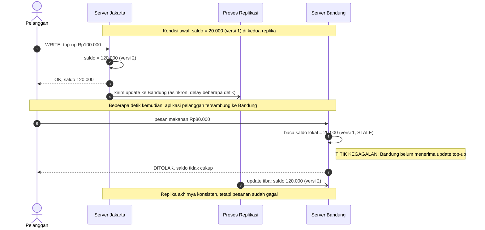
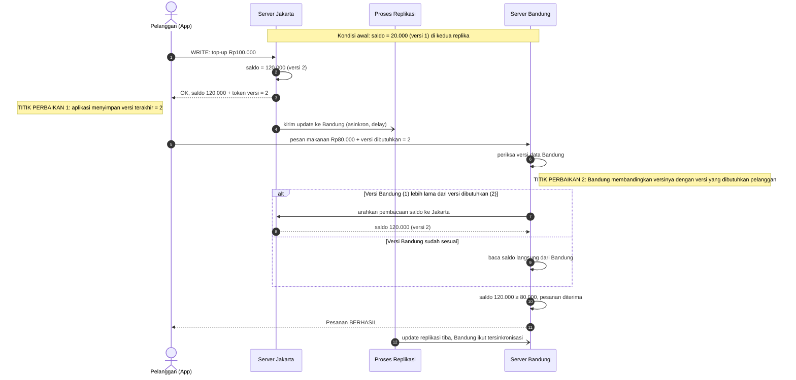

# Tugas 7 (Pekan 7) — Konsistensi Data

**Materi terkait:** Data-Centric Consistency (Sequential, Eventual), Client-Centric Consistency.

## Studi Kasus

Data saldo *e-wallet* pelanggan FoodGo berbeda antara server wilayah **Jakarta** dan **Bandung** karena replikasi antar server berjalan lambat. Contoh kasus nyata: pelanggan top-up saldo lewat server Jakarta, lalu dalam hitungan detik memesan makanan lewat aplikasi yang tersambung ke server Bandung — saldo belum ter-update, transaksi ditolak padahal saldo sebenarnya cukup.

## Tugas Kelompok

### Bagian 1 — Analisis (wajib)

1. Tentukan: apakah kasus ini **membutuhkan Sequential Consistency** (semua replika melihat urutan operasi yang sama) atau **cukup Eventual Consistency** (replika akan konsisten "pada akhirnya", boleh sementara berbeda)? Berikan argumen berbasis dampak bisnis (mis. kasus saldo *e-wallet* jauh lebih sensitif dibanding kasus "jumlah like" di media sosial).
2. Jika kalian menyimpulkan Eventual Consistency saja **tidak cukup** untuk skenario ini, usulkan pendekatan **Client-Centric Consistency** yang relevan (mis. *Read-Your-Writes*: pelanggan yang baru top-up harus selalu melihat saldo terbarunya sendiri, walau replika lain belum sinkron).
3. Gambarkan **diagram alir urutan (sequence diagram)** yang menunjukkan operasi read/write antara pelanggan, server Jakarta, server Bandung, dan proses replikasi — untuk skenario **tanpa** jaminan konsistensi (bug terjadi) DAN skenario **dengan** solusi yang kalian usulkan (bug teratasi). Pakai Mermaid (`sequenceDiagram`) di `README.md` — lihat contoh cara pakai di Tugas 2.

### Bagian 2 — Simulasi (opsional, nilai tambah)

Skeleton `src/replica_simulation.py` mensimulasikan dua replika (Jakarta & Bandung) dengan delay replikasi buatan. Lengkapi TODO untuk:
1. Menunjukkan kondisi **inconsistent read** (replika Bandung masih menunjukkan saldo lama walau Jakarta sudah update).
2. Mengimplementasikan mekanisme **Read-Your-Writes** sederhana (mis. dengan version/timestamp per client) yang memperbaiki masalah tersebut.

```bash
python3 src/replica_simulation.py
```

## Struktur Submission

```
tugas-07-konsistensi-data/
├── README.md      # Analisis konsistensi + sequence diagram Mermaid
├── JURNAL.md
├── src/            # (opsional) simulasi replikasi
└── bukti/          # (jika mengerjakan simulasi) output program
```

## Rubrik Penilaian (Tugas 7)

| Komponen | Bobot | Kriteria |
|---|---|---|
| Ketepatan pemilihan model konsistensi | 30% | Argumen berbasis dampak bisnis nyata, bukan hafalan definisi |
| Kualitas sequence diagram | 30% | Menunjukkan jelas titik kegagalan & titik perbaikan |
| Usulan solusi client-centric | 25% | Solusi konkret dan dapat diimplementasikan (bukan wacana abstrak) |
| Proses & kontribusi kelompok | 15% | `JURNAL.md`, commit history (+ bonus jika simulasi dikerjakan) |

## Batasan Penggunaan AI (Level 2)

Kebijakan **Level 2 (AI Assisted Idea Generation & Structuring)** berlaku — lihat [`../RUBRIK-UMUM.md`](../RUBRIK-UMUM.md). Boleh bertanya konsep umum consistency model ke AI untuk brainstorming; **tidak boleh** meminta AI menuliskan analisis akhir/sequence diagram atau isi `# TODO` di `src/replica_simulation.py` yang tinggal ditempel. Catat pemakaian AI di "Log Penggunaan AI" pada `JURNAL.md`.

- Sebagai bukti pemahaman konsep (bukan hafalan jawaban skenario FoodGo saja), `README.md` wajib menyertakan **satu skenario tambahan** yang kalian buat sendiri (mis. kasus lain di aplikasi ojek online) dan menentukan model konsistensi yang tepat untuk skenario tambahan tersebut.

## Analisis
### 1. Model Konsistensi
Sistem FoodGo sebaiknya menggunakan Eventual Consistency yang dilengkapi Client-Centric Consistency melalui Read-Your-Writes.

Eventual Consistency memungkinkan server Jakarta dan Bandung memiliki data berbeda sementara hingga proses replikasi selesai. Namun, pendekatan ini saja tidak cukup untuk sistem e-wallet karena perbedaan saldo dapat menyebabkan transaksi ditolak meskipun saldo pelanggan sebenarnya mencukupi.

Sequential Consistency dapat menjaga urutan operasi yang sama pada seluruh replika, tetapi membutuhkan sinkronisasi lebih ketat yang berpotensi menambah keterlambatan. Oleh karena itu, Read-Your-Writes lebih sesuai karena pelanggan tetap dapat membaca saldo terbarunya melalui server yang sudah memiliki versi data terbaru, meskipun replika lain belum tersinkronisasi.

### 2. Solusi Client-Centric Consistency menggunakan Read-Your-Writes

Read-Your-Writes merupakan mekanisme konsistensi yang memastikan pengguna dapat membaca kembali perubahan data yang sebelumnya telah dilakukan oleh pengguna tersebut.

Pada sistem FoodGo, mekanisme ini diterapkan dengan menggunakan version number pada setiap perubahan saldo.

Alur penerapannya adalah:
1. Pelanggan melakukan top-up melalui server Jakarta.
2. Server Jakarta memperbarui saldo dan menaikkan nomor versi data.
3. Server Jakarta mengirimkan informasi replikasi ke Bandung dengan jeda waktu tertentu.
4. Ketika pelanggan membaca saldo melalui Bandung, sistem memeriksa versi data yang tersedia.
5. Jika versi Bandung lebih lama daripada versi yang dibutuhkan pelanggan, sistem mengarahkan permintaan pembacaan ke Jakarta yang sudah memiliki data terbaru.
6. Jika versi Bandung sudah sesuai, pelanggan dapat membaca saldo langsung dari Bandung.
Dengan mekanisme tersebut, pelanggan tetap dapat melihat saldo terbaru tanpa harus menunggu seluruh replika selesai melakukan sinkronisasi.

### 3. Diagram alir urutan (sequence diagram)

### 3.1 Skenario TANPA jaminan konsistensi (bug terjadi)



### 3.2 Skenario DENGAN Read-Your-Writes (bug teratasi)



### 3.3 Penjelasan

| Aspek | Tanpa Jaminan Konsistensi | Dengan Read-Your-Writes |
|---|---|---|
| **Titik kegagalan** | Langkah 6-7: Bandung membaca saldo basi lalu menolak pesanan | Tidak ada, karena Bandung memeriksa versi sebelum menjawab |
| **Titik perbaikan** | - | Langkah 3 (aplikasi menyimpan token versi) dan langkah 6 (Bandung memeriksa versi) |
| **Saat Bandung tertinggal** | Menjawab dengan data lama | Pembacaan diarahkan ke Jakarta yang sudah memiliki data terbaru |
| **Saat Bandung sudah sesuai** | Menjawab dari data lokal | Menjawab dari data lokal, tanpa tambahan latensi |
| **Trade-off** | Cepat tetapi salah | Latensi tambahan hanya pada permintaan pelanggan yang replikanya tertinggal |